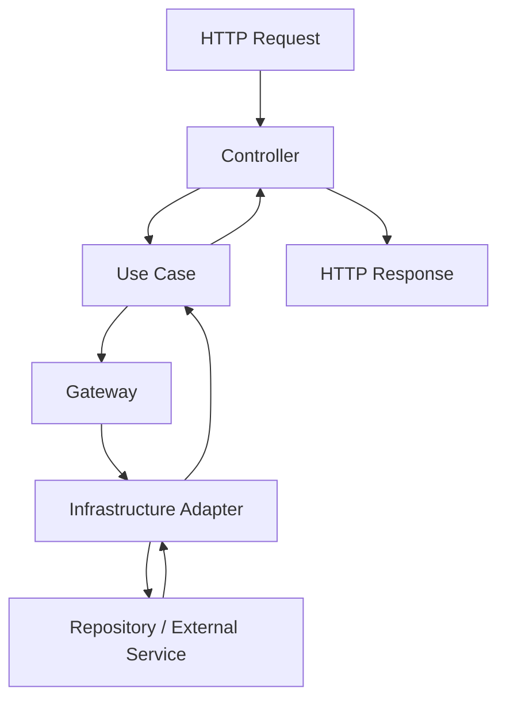
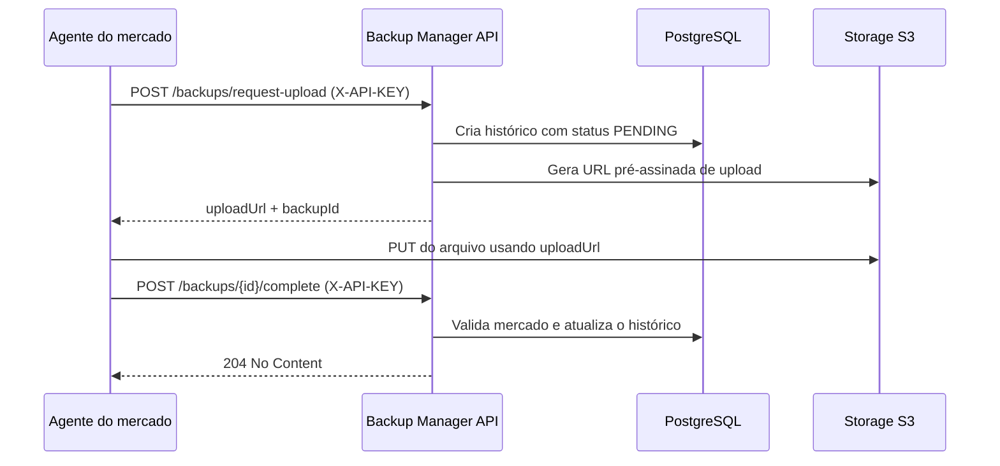

# Backup Manager — Backend

API responsável por gerenciar os mercados, coordenar a execução dos backups, registrar o histórico das operações e disponibilizar os arquivos armazenados para a equipe de suporte.

O sistema foi pensado para ambientes de supermercados que utilizam bancos Firebird locais. Um agente instalado no ambiente do mercado solicita uma autorização de upload à API, envia o arquivo diretamente para um storage compatível com S3 e, ao final, comunica o resultado ao servidor. A API mantém o histórico centralizado e oferece endpoints para consulta, acompanhamento e download dos backups.

---

## Sumário

- [Visão geral](#visão-geral)
- [Principais funcionalidades](#principais-funcionalidades)
- [Tecnologias](#tecnologias)
- [Arquitetura](#arquitetura)
- [Fluxo de um backup](#fluxo-de-um-backup)
- [Autenticação e autorização](#autenticação-e-autorização)
- [Configuração](#configuração)
- [Executando localmente](#executando-localmente)
- [Banco de dados](#banco-de-dados)
- [Referência da API](#referência-da-api)
- [Tratamento de erros](#tratamento-de-erros)
- [Agendamento de verificação](#agendamento-de-verificação)
- [Testes](#testes)

---

## Visão geral

O backend centraliza o controle dos backups de vários mercados sem transportar os arquivos de backup pela própria API. Em vez disso, utiliza **URLs pré-assinadas** para que o agente faça upload diretamente no storage.

A aplicação possui dois perfis de acesso distintos:

- **Agente do mercado:** autentica-se por API Key e só pode iniciar e concluir backups vinculados ao próprio mercado.
- **Equipe interna:** autentica-se por JWT em cookies HttpOnly. Os usuários possuem os papéis `SUPPORT` ou `ADMIN`, com permissões diferentes.

O histórico de cada execução registra o mercado de origem, os horários, o tamanho do arquivo, o hash MD5, a chave do objeto no storage, o status e uma eventual mensagem de erro.

## Principais funcionalidades

- Cadastro e consulta de mercados.
- Geração de uma API Key individual para cada mercado.
- Solicitação de URL pré-assinada para upload de backup.
- Upload direto do agente para um storage compatível com S3.
- Confirmação do resultado de uma execução de backup.
- Isolamento das operações do agente por mercado.
- Consulta paginada do histórico, com filtro por período.
- Geração de URLs pré-assinadas para download de backups concluídos com sucesso.
- Autenticação da equipe com access token e refresh token.
- Revogação de sessões e controle do estado dos refresh tokens via Redis.
- Controle de acesso baseado nos papéis `SUPPORT`, `ADMIN` e `AGENT`.
- Indicadores agregados para o dashboard.
- Verificação agendada de backups não realizados dentro do prazo esperado.

## Tecnologias

| Tecnologia | Responsabilidade |
|---|---|
| Java 21 | Linguagem e runtime da aplicação |
| Spring Boot | Inicialização e composição da aplicação |
| Spring Web | Exposição dos endpoints REST |
| Spring Security | Autenticação e autorização |
| Spring Data JPA / Hibernate | Persistência e consultas relacionais |
| PostgreSQL | Banco de dados principal |
| Flyway | Versionamento e execução das migrations |
| Redis | Controle de refresh tokens e sessões revogadas |
| AWS SDK for Java (S3) | Integração com storage compatível com S3 |
| JWT | Access tokens e refresh tokens |
| MapStruct | Conversão entre entidades de persistência e objetos de domínio |
| Lombok | Redução de código repetitivo |
| JUnit 5 / Mockito | Testes automatizados dos casos de uso |

---

## Arquitetura

O backend segue uma organização inspirada em **Clean Architecture** e **Ports & Adapters (Hexagonal Architecture)**. As regras da aplicação dependem de contratos (gateways), enquanto os detalhes de infraestrutura implementam esses contratos.

```text
src/main/java/com/microservice/backupserver/
│
├── application/
│   ├── exceptions/       # Exceções da aplicação
│   ├── gateways/         # Portas de entrada/saída (contratos)
│   ├── usecases/         # Casos de uso
│   └── usecases/dto/     # DTOs internos da aplicação
│
├── controller/
│   ├── dto/              # Contratos HTTP de request/response
│   ├── handler/          # Tratamento global de exceções
│   └── *.java            # Controllers REST
│
├── domain/
│   ├── enums/            # Enumerações do domínio
│   └── *.java            # Modelos de domínio
│
└── infrastructure/
    ├── adapters/         # Implementações dos gateways
    ├── config/           # Configurações e composição dos casos de uso
    ├── persistence/      # Repositórios, entidades e mappers JPA
    ├── scheduling/       # Tarefas agendadas
    └── security/         # Filtros e configuração de segurança
```

### Responsabilidades das camadas

- **Domain:** representa os conceitos centrais, como `Market`, `BackupHistory` e `User`, sem depender de controllers ou repositórios Spring.
- **Application:** concentra os casos de uso e define gateways que descrevem as operações necessárias, sem acoplar as regras de negócio às tecnologias externas.
- **Infrastructure:** implementa os gateways usando PostgreSQL, Redis e S3; também contém os filtros de segurança e o agendamento.
- **Controller:** recebe requisições HTTP, valida os dados de entrada e converte os resultados em respostas da API.

Exemplo do fluxo de uma consulta:



Essa estrutura permite substituir detalhes de persistência ou integrações externas sem transferir essas dependências para as regras centrais da aplicação.

## Fluxo de um backup

O processo de backup é dividido entre o agente, a API e o storage.



### Etapas

1. O agente envia o nome e o tamanho do arquivo para `POST /api/v1/backups/request-upload`, autenticando-se com a API Key do mercado no header `X-API-KEY`.
2. A API cria um registro de histórico com status `PENDING` e gera uma URL pré-assinada de upload, válida por **30 minutos**.
3. O agente envia o arquivo diretamente ao storage usando a URL recebida. O conteúdo do arquivo não trafega pela API.
4. Após o upload, o agente chama `POST /api/v1/backups/{backupId}/complete`, informando o resultado, o hash MD5 e, em caso de falha, a mensagem correspondente.
5. A API verifica se o backup pertence ao mercado autenticado e se a execução ainda está pendente antes de atualizar o histórico.

Para download, um usuário autorizado solicita `GET /api/v1/backups/{backupId}/download-url`. A API só gera a URL se o backup estiver com status `SUCCESS`. A URL pré-assinada de download é válida por **15 minutos**.

### Status de backup

| Status | Significado |
|---|---|
| `PENDING` | A execução foi registrada e aguarda conclusão. |
| `SUCCESS` | O agente informou que o backup foi concluído. |
| `FAILED` | A execução terminou com falha ou foi marcada como não realizada pelo watchdog. |

---

## Autenticação e autorização

A API utiliza dois mecanismos de autenticação porque atende dois tipos distintos de cliente.

### 1. Agentes — API Key

Cada mercado possui uma API Key própria. O agente deve enviá-la no header:

```http
X-API-KEY: <API_KEY_DO_MERCADO>
```

O filtro `ApiKeyAuthenticationFilter` localiza o mercado pela chave e só autentica mercados ativos. A identidade autenticada é associada ao papel `AGENT`.

O agente pode iniciar e concluir backups. A conclusão também valida que o `marketId` do histórico corresponde ao mercado autenticado, impedindo que um mercado altere a execução de outro.

### 2. Equipe interna — JWT em cookies

Os usuários internos fazem login com `username` e `password`. Após autenticação, a API envia dois cookies:

- `accessToken`: token de acesso usado nas requisições protegidas.
- `refreshToken`: token utilizado para renovar a sessão.

Ambos são configurados como `HttpOnly`, `Secure` e `SameSite=Lax`. O frontend não precisa ler os tokens: o navegador os envia automaticamente quando a chamada é feita com credenciais habilitadas.

Configuração padrão de validade:

| Token | Validade padrão |
|---|---:|
| Access token | 15 minutos |
| Refresh token | 7 dias |

Os tempos podem ser alterados pelas variáveis de ambiente descritas na seção [Configuração](#configuração).

O estado dos refresh tokens é mantido no Redis. O token é armazenado por meio de seu hash SHA-256, e sessões revogadas são registradas com expiração compatível com o prazo restante do refresh token.

### Papéis e permissões

| Recurso | `AGENT` | `SUPPORT` | `ADMIN` |
|---|:---:|:---:|:---:|
| Solicitar upload de backup | ✓ | — | — |
| Concluir backup | ✓ | — | — |
| Consultar dashboard | — | ✓ | ✓ |
| Listar, consultar e cadastrar mercados | — | ✓ | ✓ |
| Consultar histórico e solicitar URL de download | — | ✓ | ✓ |
| Listar usuários | — | — | ✓ |
| Criar usuários de suporte | — | — | ✓ |
| Remover usuários | — | — | ✓ |

O endpoint `GET /api/v1/auth/me` retorna os dados do usuário associado ao access token atual.

**Provisionamento inicial:** o endpoint de criação de usuários cria contas com papel `SUPPORT`. A primeira conta `ADMIN` precisa ser provisionada por um procedimento administrativo confiável, diretamente no banco ou por uma rotina de bootstrap controlada. Não existe cadastro público de administrador.

---

## Configuração

### Pré-requisitos

- Java 21.
- Maven (ou o Maven Wrapper incluído no repositório).
- PostgreSQL.
- Redis.
- Um serviço de armazenamento compatível com a API S3.

### Variáveis de ambiente

A aplicação lê as configurações abaixo. Não armazene credenciais reais no repositório.

| Variável | Obrigatória | Descrição |
|---|:---:|---|
| `SPRING_DATASOURCE_URL` | Sim | JDBC URL do PostgreSQL. Ex.: `jdbc:postgresql://localhost:5432/backupmanager` |
| `SPRING_DATASOURCE_USERNAME` | Sim | Usuário do PostgreSQL. |
| `SPRING_DATASOURCE_PASSWORD` | Sim | Senha do PostgreSQL. |
| `STORAGE_S3_ENDPOINT` | Sim | Endpoint do serviço compatível com S3. |
| `STORAGE_S3_BUCKET_NAME` | Sim | Bucket utilizado para armazenar os backups. |
| `STORAGE_S3_REGION` | Sim | Região informada ao SDK S3. |
| `STORAGE_S3_ACCESS_KEY` | Sim | Access key do storage. |
| `STORAGE_S3_SECRET_KEY` | Sim | Secret key do storage. |
| `JWT_SECRET` | Sim | Segredo usado para assinar e validar os JWTs. |
| `API_SECURITY_TOKEN_ACCESS_EXPIRATION` | Não | Validade do access token em milissegundos. Padrão: `900000`. |
| `API_SECURITY_TOKEN_REFRESH_EXPIRATION` | Não | Validade do refresh token em milissegundos. Padrão: `604800000`. |
| `SPRING_DATA_REDIS_HOST` | Não | Host do Redis. O padrão do Spring Boot é `localhost`. |
| `SPRING_DATA_REDIS_PORT` | Não | Porta do Redis. O padrão do Spring Boot é `6379`. |

O segredo JWT deve ter tamanho suficiente para o algoritmo HMAC utilizado pela biblioteca JWT. Utilize um valor aleatório forte, com pelo menos 32 bytes, e mantenha o mesmo segredo entre reinicializações e instâncias da aplicação.

Exemplo para gerar um segredo local:

```bash
openssl rand -base64 48
```

### Exemplo de variáveis para desenvolvimento

Ajuste os valores para as suas instalações locais:

```bash
export SPRING_DATASOURCE_URL='jdbc:postgresql://localhost:5432/backupmanager'
export SPRING_DATASOURCE_USERNAME='postgres'
export SPRING_DATASOURCE_PASSWORD='sua_senha_local'

export STORAGE_S3_ENDPOINT='http://localhost:9000'
export STORAGE_S3_BUCKET_NAME='backups'
export STORAGE_S3_REGION='us-east-1'
export STORAGE_S3_ACCESS_KEY='sua_access_key'
export STORAGE_S3_SECRET_KEY='sua_secret_key'

export JWT_SECRET='substitua_por_um_segredo_aleatorio_com_pelo_menos_32_bytes'

export SPRING_DATA_REDIS_HOST='localhost'
export SPRING_DATA_REDIS_PORT='6379'
```

> **Atenção às URLs pré-assinadas:** o endpoint configurado em `STORAGE_S3_ENDPOINT` é utilizado na comunicação e na assinatura das URLs. Ele precisa ser acessível pelo cliente que receberá a URL — o agente durante o upload e o navegador durante o download. Um hostname resolvível apenas dentro de uma rede privada não funcionará para clientes externos.

---

## Executando localmente

1. Inicie PostgreSQL, Redis e o serviço de storage S3.
2. Crie o banco de dados indicado em `SPRING_DATASOURCE_URL`.
3. Crie o bucket configurado em `STORAGE_S3_BUCKET_NAME` no serviço de storage.
4. Configure as variáveis de ambiente.
5. Na raiz do backend, execute:

```bash
./mvnw clean test
```

Para iniciar a aplicação:

```bash
./mvnw spring-boot:run
```

A API ficará disponível, por padrão, em:

```text
http://localhost:8080
```

As migrations do Flyway são executadas na inicialização. O Hibernate está configurado com `ddl-auto: validate`: ele valida o mapeamento das entidades em relação ao schema, mas não substitui as migrations nem cria/atualiza as tabelas automaticamente.

### CORS e frontend

Para chamadas feitas pelo navegador, configure o CORS para a origem do frontend e permita credenciais, pois a sessão da equipe utiliza cookies HttpOnly. Quando `allowCredentials` está habilitado, a origem não pode ser `*`; utilize a origem específica do frontend nos ambientes compartilhados e de produção.

Em produção, utilize HTTPS. Os cookies de autenticação são emitidos com a flag `Secure`.

---

## Banco de dados

O schema é versionado pelo Flyway em `src/main/resources/db/migration`.

### `markets`

Armazena os mercados monitorados.

| Coluna | Descrição |
|---|---|
| `id` | Identificador UUID. |
| `name` | Nome do mercado. |
| `cnpj` | CNPJ único do mercado. |
| `api_key` | API Key única usada pelo agente. |
| `expected_backup_time` | Horário esperado para o backup diário. |
| `active` | Indica se o mercado está ativo. |

### `backup_histories`

Armazena cada execução de backup e referencia o mercado de origem por `market_id`.

| Coluna | Descrição |
|---|---|
| `id` | Identificador UUID do backup. |
| `market_id` | FK para `markets.id`. |
| `created_at` | Data e hora de criação da solicitação. |
| `completed_at` | Data e hora da conclusão, quando disponível. |
| `file_size_bytes` | Tamanho informado para o arquivo. |
| `file_hash_md5` | Hash MD5 informado pelo agente. |
| `s3_key` | Chave do objeto no bucket. |
| `status` | `PENDING`, `SUCCESS` ou `FAILED`. |
| `error_message` | Detalhes de uma falha, quando aplicável. |

### `users`

Armazena as contas da equipe interna.

| Coluna | Descrição |
|---|---|
| `id` | Identificador UUID. |
| `username` | Nome de usuário único. |
| `password_hash` | Hash BCrypt da senha. |
| `role` | Papel `SUPPORT` ou `ADMIN`. |
| `active` | Indica se a conta está ativa. |
| `created_at` | Data de criação da conta. |

### Relacionamentos

- Um `Market` pode possuir vários registros em `backup_histories`.
- Cada `BackupHistory` pertence a um único `Market`.
- Usuários internos são independentes dos mercados; a associação do agente ao mercado ocorre por meio da API Key.

---

## Referência da API

**Prefixo:** `/api/v1`

Os exemplos abaixo mostram os caminhos e contratos principais. Endpoints protegidos exigem o cookie de acesso ou a API Key correspondente, conforme a tabela de permissões.

### Autenticação — `/auth`

| Método | Endpoint | Descrição | Acesso |
|---|---|---|---|
| `POST` | `/auth/login` | Autentica um usuário e define os cookies da sessão. | Público |
| `POST` | `/auth/refresh` | Renova access e refresh tokens usando o cookie de refresh. | Refresh cookie |
| `POST` | `/auth/logout` | Revoga a sessão e limpa os cookies. | Refresh cookie |
| `GET` | `/auth/me` | Retorna os dados do usuário autenticado. | Access cookie |

**Login — exemplo de request:**

```http
POST /api/v1/auth/login
Content-Type: application/json

{
  "username": "suporte",
  "password": "sua_senha"
}
```

O login responde `204 No Content` e envia os cookies `accessToken` e `refreshToken` nos headers `Set-Cookie`.

### Dashboard — `/dashboard`

| Método | Endpoint | Descrição | Acesso |
|---|---|---|---|
| `GET` | `/dashboard` | Retorna indicadores agregados para o período informado. | `SUPPORT`, `ADMIN` |

Parâmetros obrigatórios:

| Parâmetro | Tipo | Descrição |
|---|---|---|
| `startDate` | `LocalDateTime` | Início do período. |
| `endDate` | `LocalDateTime` | Fim do período. |

Exemplo:

```http
GET /api/v1/dashboard?startDate=2026-10-01T00:00:00&endDate=2026-10-31T23:59:59
```

Resposta ilustrativa:

```json
{
  "activeMarkets": 12,
  "totalBackups": 340,
  "successfulBackups": 326,
  "failedBackups": 10,
  "pendingBackups": 4
}
```

`activeMarkets` representa a quantidade atual de mercados ativos. As contagens de backups consideram o intervalo informado.

### Mercados — `/markets`

| Método | Endpoint | Descrição | Acesso |
|---|---|---|---|
| `POST` | `/markets/create` | Cadastra um mercado e gera sua API Key. | `SUPPORT`, `ADMIN` |
| `GET` | `/markets` | Lista mercados ativos. | `SUPPORT`, `ADMIN` |
| `GET` | `/markets/overview` | Lista mercados ativos com informações do último backup. | `SUPPORT`, `ADMIN` |
| `GET` | `/markets/{id}` | Consulta os dados de um mercado. | `SUPPORT`, `ADMIN` |

**Cadastro — exemplo de request:**

```http
POST /api/v1/markets/create
Content-Type: application/json

{
  "name": "Mercado Central",
  "cnpj": "12.345.678/0001-90",
  "expectedBackupTime": "02:00:00"
}
```

A resposta do cadastro contém o identificador do mercado e sua API Key. Os endpoints de listagem e consulta de mercado também retornam `apiKey`; já `/markets/overview` é uma projeção voltada à tela inicial e **não inclui a API Key**.

A resposta de overview contém os dados básicos do mercado e `lastBackup`. Esse campo é `null` quando ainda não existe histórico de backup para o mercado.

### Backups — `/backups`

| Método | Endpoint | Descrição | Acesso |
|---|---|---|---|
| `POST` | `/backups/request-upload` | Registra uma execução pendente e retorna URL de upload. | `AGENT` |
| `POST` | `/backups/{id}/complete` | Informa o resultado da execução. | `AGENT` |
| `GET` | `/backups/market/{marketId}` | Consulta o histórico paginado de um mercado. | `SUPPORT`, `ADMIN` |
| `GET` | `/backups/{id}/download-url` | Gera URL pré-assinada para download. | `SUPPORT`, `ADMIN` |

**Solicitação de upload — exemplo:**

```http
POST /api/v1/backups/request-upload
X-API-KEY: <API_KEY_DO_MERCADO>
Content-Type: application/json

{
  "fileName": "backup.fbk.gz",
  "fileSizeBytes": 52428800
}
```

Resposta ilustrativa:

```json
{
  "uploadUrl": "https://storage.example/...",
  "backupId": "00000000-0000-0000-0000-000000000000"
}
```

O agente utiliza `uploadUrl` para enviar o arquivo diretamente ao storage e, depois, informa a conclusão:

```http
POST /api/v1/backups/{backupId}/complete
X-API-KEY: <API_KEY_DO_MERCADO>
Content-Type: application/json

{
  "status": "SUCCESS",
  "fileHashMd5": "d41d8cd98f00b204e9800998ecf8427e",
  "errorMessage": null
}
```

Para uma execução com falha, informe `status: "FAILED"` e uma mensagem em `errorMessage`.

**Histórico por mercado:**

```http
GET /api/v1/backups/market/{marketId}?startDate=2026-10-01&endDate=2026-10-31&page=0&size=20
```

`startDate` e `endDate` são opcionais. Quando omitidos, o backend considera os últimos 30 dias até a data atual. A resposta é paginada pelo Spring Data.

**Solicitação de download:**

```http
GET /api/v1/backups/{backupId}/download-url
```

Retorna um objeto com a propriedade `url`. A API não disponibiliza download para registros cujo status não seja `SUCCESS`.

### Usuários — `/users`

| Método | Endpoint | Descrição | Acesso |
|---|---|---|---|
| `GET` | `/users` | Lista usuários ativos. | `ADMIN` |
| `POST` | `/users/create` | Cria um usuário com papel `SUPPORT`. | `ADMIN` |
| `POST` | `/users/delete` | Remove um usuário pelo UUID. | `ADMIN` |

**Criação — exemplo:**

```http
POST /api/v1/users/create
Content-Type: application/json

{
  "username": "novo.suporte",
  "password": "uma_senha_forte"
}
```

As senhas são armazenadas usando BCrypt. O endpoint não permite definir o papel `ADMIN`; novas contas criadas por essa rota recebem o papel `SUPPORT`.

### Health check

| Método | Endpoint | Descrição | Acesso |
|---|---|---|---|
| `GET` | `/actuator/health` | Verificação de saúde da aplicação. | Público |

---

## Tratamento de erros

As exceções da aplicação são centralizadas em `GlobalExceptionHandler`. As respostas seguem o formato `StandardError`:

```json
{
  "date": "2026-10-31",
  "status": 404,
  "error": "Resource Not Found",
  "message": "Mercado não encontrado.",
  "path": "/api/v1/markets/00000000-0000-0000-0000-000000000000"
}
```

Principais mapeamentos:

| HTTP | Situação |
|---:|---|
| `400` | Violação de regra de negócio, argumento inválido ou falha de validação. |
| `401` | Requisição sem autenticação válida. |
| `403` | Usuário autenticado sem permissão para o recurso. |
| `404` | Recurso não encontrado. |
| `409` | Conflito, como cadastro duplicado. |
| `502` | Falha de comunicação com o storage. |
| `500` | Erro interno inesperado. |

---

## Agendamento de verificação

O `BackupWatchdogScheduler` executa a verificação de backups não realizados por meio de uma tarefa agendada. O agendamento atual é:

```java
@Scheduled(cron = "0 0 3-8 * * *")
```

Ou seja, a rotina é executada no minuto zero das horas entre **03:00 e 08:00**, conforme o fuso horário da JVM.

A regra de negócio considera uma tolerância de **duas horas** após o horário esperado de backup do mercado. Quando o prazo é excedido sem uma execução válida no dia, o histórico é registrado ou atualizado como `FAILED`, com uma mensagem indicando o tempo limite.

Como o domínio utiliza `LocalDateTime`, configure o fuso horário da JVM de acordo com o horário operacional dos mercados. O horário efetivo do scheduler também depende do fuso configurado no processo Java.

---

## Testes

Os testes automatizados concentram-se nos casos de uso e cobrem cenários de sucesso e falha, incluindo:

- Autenticação, logout e rotação de refresh tokens.
- Criação e consulta de mercados.
- Solicitação, conclusão e download de backups.
- Isolamento de backups por mercado.
- Consulta do histórico por período.
- Detecção de backups não realizados.
- Criação e remoção de usuários.

Execute a suíte completa com:

```bash
./mvnw clean test
```

O workflow de CI executa os testes em Java 21 para alterações direcionadas à branch `main`, incluindo pushes e pull requests.

---

**Backup Manager — Backend**  
API REST para gerenciamento, rastreabilidade e armazenamento de backups de bancos de dados de mercados.
